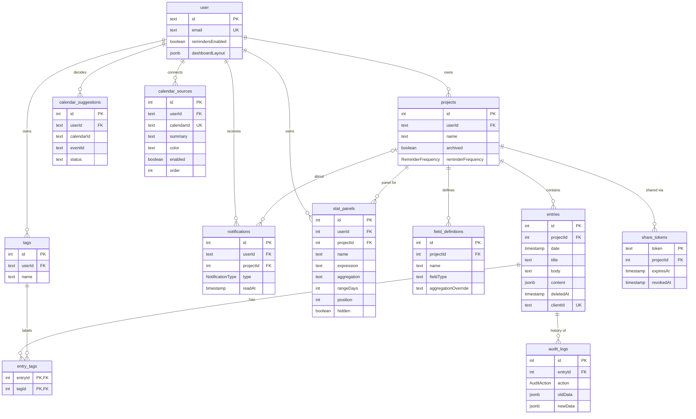

import AiDeclaration from '@site/src/components/AiDeclaration';

# Database Design

## Overview

The UniLogs database supports users, projects, custom field definitions,
entries, tags, entry history, calendar suggestions, share links and
notifications. Users can give each project its own entry format, and existing
entries are kept when that format changes.

It has **fifteen tables**. Four are required by Better Auth (`user`,
`session`, `account` and `verification`). The other eleven belong to UniLogs:
`projects`, `field_definitions`, `entries`, `tags`, `entry_tags`,
`audit_logs`, `calendar_suggestions`, `calendar_sources`, `stat_panels`,
`share_tokens` and `notifications`. A twelfth UniLogs model, `Task`, is in
the schema but has no migration — [see below](#proposed-not-yet-built-tasks).

Since Sprint 4 the logbook is _hard to lose_: entries are **soft-deleted**
into a recoverable trash, every correction is preserved as an entry version,
and the dashboard layout, custom stat panels and calendar choices are stored
server-side.

Column names below are the real names in the database. Prisma keeps the
camelCase field names from `backend/prisma/schema.prisma`, and `@@map` only
renames the tables.

## Entity Relationship Diagram

Drawn from `backend/prisma/schema.prisma`. The Better Auth tables `session`,
`account` and `verification` are left out for readability; each of the first
two belongs to one `user`.

Original Sprint 1 diagram

The diagram from the Sprint 1 design, kept for reference. It predates tags
belonging to users, entry titles and bodies, share links, reminders and
notifications.

## Tables

### User

The `user` table stores user accounts. Its structure follows the schema
Better Auth requires, plus one UniLogs column.

| Column             | Type      | Constraints              |
| ------------------ | --------- | ------------------------ |
| `id`               | text      | Primary key              |
| `name`             | text      | Not null                 |
| `email`            | text      | Not null, unique         |
| `emailVerified`    | boolean   | Not null, default false  |
| `image`            | text      |                          |
| `createdAt`        | timestamp | Not null                 |
| `updatedAt`        | timestamp | Not null                 |
| `remindersEnabled` | boolean   | Not null, default `true` |
| `dashboardLayout`  | jsonb     |                          |

`remindersEnabled` is the account-wide switch in **Settings**. When it is off,
the reminder scheduler skips all of the user's projects.

`dashboardLayout` is a JSON document holding which widgets appear on the
dashboard, their positions and sizes — including pinned custom stat panels,
which appear as `statPanel:<id>` entries. It moved from the browser's
`localStorage` to the server in Sprint 4, so the arrangement is identical on
every device.

### Session

The `session` table stores active login sessions issued by Better Auth. Each
session belongs to one user and carries the token read from the session cookie
on every request.

| Column      | Type      | Constraints                        |
| ----------- | --------- | ---------------------------------- |
| `id`        | text      | Primary key                        |
| `expiresAt` | timestamp | Not null                           |
| `token`     | text      | Not null, unique                   |
| `createdAt` | timestamp | Not null                           |
| `updatedAt` | timestamp | Not null                           |
| `ipAddress` | text      |                                    |
| `userAgent` | text      |                                    |
| `userId`    | text      | Not null, foreign key to `user.id` |

### Account

The `account` table stores the credentials and provider tokens Better Auth uses
to authenticate a user: a password hash for email/password sign-in, or OAuth
tokens for Google. A user can have more than one linked account. `scope`
records which Google permissions were granted, which is how the API knows
whether Google Calendar has been connected.

| Column                  | Type      | Constraints                        |
| ----------------------- | --------- | ---------------------------------- |
| `id`                    | text      | Primary key                        |
| `accountId`             | text      | Not null                           |
| `providerId`            | text      | Not null                           |
| `userId`                | text      | Not null, foreign key to `user.id` |
| `accessToken`           | text      |                                    |
| `refreshToken`          | text      |                                    |
| `idToken`               | text      |                                    |
| `accessTokenExpiresAt`  | timestamp |                                    |
| `refreshTokenExpiresAt` | timestamp |                                    |
| `scope`                 | text      |                                    |
| `password`              | text      |                                    |
| `createdAt`             | timestamp | Not null                           |
| `updatedAt`             | timestamp | Not null                           |

### Verification

The `verification` table stores short-lived tokens used for email verification
and password reset.

| Column       | Type      | Constraints |
| ------------ | --------- | ----------- |
| `id`         | text      | Primary key |
| `identifier` | text      | Not null    |
| `value`      | text      | Not null    |
| `expiresAt`  | timestamp | Not null    |
| `createdAt`  | timestamp | Not null    |
| `updatedAt`  | timestamp | Not null    |

### Projects

The `projects` table stores the projects users create. Each project belongs to
one user and holds its field definitions and entries.

| Column              | Type                | Constraints                        |
| ------------------- | ------------------- | ---------------------------------- |
| `id`                | integer             | Primary key                        |
| `name`              | text                | Not null                           |
| `description`       | text                |                                    |
| `archived`          | boolean             | Not null, default `false`          |
| `reminderFrequency` | `ReminderFrequency` | Not null, default `WEEKLY`         |
| `lastDigestSentAt`  | timestamp           |                                    |
| `userId`            | text                | Not null, foreign key to `user.id` |

`archived` lets a user retire a project without losing its entries. Archived
projects are hidden from the default project list but stay intact and can be
unarchived. `reminderFrequency` is chosen during project creation.
`lastDigestSentAt` stops the hourly reminder sweep from emailing about the same
quiet project more than once per period.

### Field definitions

The `field_definitions` table stores the custom fields that define the format
of entries in a project.

| Column                | Type    | Constraints                            |
| --------------------- | ------- | -------------------------------------- |
| `id`                  | integer | Primary key                            |
| `projectId`           | integer | Not null, foreign key to `projects.id` |
| `name`                | text    | Not null                               |
| `fieldType`           | text    | Not null                               |
| `aggregationOverride` | text    | `sum`, `average`, `max`, `min` or null |

`fieldType` is one of `text`, `number`, `duration`, `boolean` (shown as
"Toggle" in the app) or `date`. `aggregationOverride` lets a user choose how a
numeric field is summarised in the project's statistics. When it is null,
UniLogs picks a sensible default for the field type.

### Entries

The `entries` table stores the logbook entries themselves. Each entry belongs
to a project and stores its custom field values as JSON.

| Column      | Type      | Constraints                            |
| ----------- | --------- | -------------------------------------- |
| `id`        | integer   | Primary key                            |
| `projectId` | integer   | Not null, foreign key to `projects.id` |
| `date`      | timestamp | Not null                               |
| `createdAt` | timestamp | Not null, default now                  |
| `content`   | jsonb     | Not null                               |
| `title`     | text      |                                        |
| `body`      | text      | Markdown                               |
| `deletedAt` | timestamp |                                        |
| `clientId`  | text      | Unique                                 |

An entry must have at least one of a title, a body or a field value. The API
rejects wholly empty entries.

`deletedAt` implements **soft delete**. When it is set the entry disappears
from every normal read path — a Prisma extension in `src/lib/prisma.ts`
filters those rows out automatically — but stays recoverable from the
project's trash until it is restored. There is no permanent single-entry
delete.

`clientId` is a client-generated id set only by `POST /api/entries/sync`. It
makes **offline capture idempotent**: if a queued batch is re-sent after a
retry, the backend matches on `clientId` instead of creating a duplicate
entry. Entries logged normally through the app don't have one.

### Tags

The `tags` table stores labels that can be attached to entries. Tags belong to
a user, so two users can each have a tag called "exam prep" without sharing it.

| Column   | Type    | Constraints                        |
| -------- | ------- | ---------------------------------- |
| `id`     | integer | Primary key                        |
| `name`   | text    | Not null                           |
| `userId` | text    | Not null, foreign key to `user.id` |

The combination of `userId` and `name` is unique, so a user can't create the
same tag twice.

### Entry_tags

The `entry_tags` table is a junction table that connects entries and tags,
giving a many-to-many relationship.

| Column    | Type    | Constraints                           |
| --------- | ------- | ------------------------------------- |
| `entryId` | integer | Not null, foreign key to `entries.id` |
| `tagId`   | integer | Not null, foreign key to `tags.id`    |

`entryId` and `tagId` together form the primary key, so the same tag can't be
attached to the same entry twice.

### Audit_logs

The `audit_logs` table stores the history of changes to entries. Each change
creates a record of the action and the data before and after it.

| Column       | Type          | Constraints                           |
| ------------ | ------------- | ------------------------------------- |
| `id`         | integer       | Primary key                           |
| `entryId`    | integer       | Not null, foreign key to `entries.id` |
| `action`     | `AuditAction` | Not null                              |
| `oldData`    | jsonb         |                                       |
| `newData`    | jsonb         |                                       |
| `modifiedAt` | timestamp     | Not null, default now                 |

Since Sprint 4 the snapshots in `oldData`/`newData` store only `{ title, body,
content, date, tagIds }` — a one-time lossless backfill normalised rows
written before that. Restoring an earlier version writes a brand-new `UPDATE`
row instead of rewriting any existing one, so history stays append-only and
can be replayed to reconstruct the logbook as it stood on any date (the
\"as-at\" view).

### Calendar_suggestions

The `calendar_suggestions` table records what a user has already decided about
a Google Calendar event offered as a possible entry, so the same event isn't
suggested again after being accepted or dismissed.

| Column      | Type      | Constraints                         |
| ----------- | --------- | ----------------------------------- |
| `id`        | integer   | Primary key                         |
| `userId`    | text      | Not null, foreign key to `user.id`  |
| `eventId`   | text      | Not null                            |
| `status`    | text      | Not null (`ACCEPTED` or `REJECTED`) |
| `createdAt` | timestamp | Not null, default now               |

Google event ids are only unique inside a single calendar, so the unique key
is the triple (`userId`, `calendarId`, `eventId`): deciding on the same event
twice within a calendar is rejected by the database rather than relying on
application code to catch it.

### Calendar_sources

The `calendar_sources` table stores which of the user's Google calendars feed
the app, and how each one is displayed. It is persisted rather than re-derived
from the Google API on every load, so enable/disable and colour choices stay
stable across devices.

| Column        | Type    | Constraints                            |
| ------------- | ------- | -------------------------------------- |
| `id`          | integer | Primary key                            |
| `userId`      | text    | Not null, foreign key to `user.id`     |
| `calendarId`  | text    | Not null, the Google calendar's own id |
| `summary`     | text    | Not null, e.g. "Lectures"              |
| `description` | text    |                                        |
| `color`       | text    | A Google calendar colour id            |
| `enabled`     | boolean | Not null, default `true`               |
| `order`       | integer | Not null, default `0`                  |

The pair (`userId`, `calendarId`) is unique, so the same Google calendar can't
be listed twice for one user. Suggestions, upcoming events and the calendar
view all respect `enabled`.

### Stat_panels

The `stat_panels` table stores the custom statistics a user builds from an
arithmetic expression over a project's numeric fields (`weight * reps`, for
example). The expression is evaluated safely on the server — never with
`eval` — for every entry, then aggregated with Sum or Average over a date
range.

| Column        | Type    | Constraints                               |
| ------------- | ------- | ----------------------------------------- |
| `id`          | integer | Primary key                               |
| `userId`      | text    | Not null, foreign key to `user.id`        |
| `projectId`   | integer | Not null, foreign key to `projects.id`    |
| `name`        | text    | Not null                                  |
| `expression`  | text    | Not null, e.g. `weight * reps`            |
| `aggregation` | text    | Not null, default `sum` (`sum`/`average`) |
| `rangeDays`   | integer | Not null, default `30`                    |
| `position`    | integer | Not null, default `0`                     |
| `hidden`      | boolean | Not null, default `false`                 |

A panel lives on a project but belongs to its creator; pinning it to the
dashboard is recorded as a `statPanel:<id>` entry in `user.dashboardLayout`.

### Share_tokens

The `share_tokens` table stores the read-only report links a user creates for
a project. The token itself is the primary key and appears in the link
(`/r/{token}` in the app, `/share/{token}` in the API).

| Column             | Type      | Constraints                            |
| ------------------ | --------- | -------------------------------------- |
| `token`            | text      | Primary key                            |
| `projectId`        | integer   | Not null, foreign key to `projects.id` |
| `expiresAt`        | timestamp | Not null                               |
| `revokedAt`        | timestamp |                                        |
| `includeBodies`    | boolean   | Not null, default `false`              |
| `defaultRangeDays` | integer   | Not null, default `30`                 |
| `createdAt`        | timestamp | Not null, default now                  |

A link works only while it is unexpired and `revokedAt` is null. Revoking sets
`revokedAt` instead of deleting the row, so a revoked link can never start
working again by accident. `includeBodies` decides whether the public report
shows entry text or only titles and fields.

### Notifications

The `notifications` table stores the in-app notification feed shown under the
bell.

| Column      | Type               | Constraints                        |
| ----------- | ------------------ | ---------------------------------- |
| `id`        | integer            | Primary key                        |
| `userId`    | text               | Not null, foreign key to `user.id` |
| `projectId` | integer            | Foreign key to `projects.id`       |
| `type`      | `NotificationType` | Not null                           |
| `title`     | text               | Not null                           |
| `body`      | text               | Not null                           |
| `readAt`    | timestamp          |                                    |
| `createdAt` | timestamp          | Not null, default now              |

`projectId` is optional because not every notification is about a project.
`readAt` is null until the user reads it.

## Enums

| Enum                | Values                       | Used by                                                                         |
| ------------------- | ---------------------------- | ------------------------------------------------------------------------------- |
| `AuditAction`       | `CREATE`, `UPDATE`, `DELETE` | `audit_logs.action`: whether the entry was created, modified or deleted         |
| `ReminderFrequency` | `DAILY`, `WEEKLY`, `OFF`     | `projects.reminderFrequency`: how long a project can go quiet before a reminder |
| `NotificationType`  | `REMINDER`, `SYSTEM`         | `notifications.type`: a reminder about a quiet project, or a general message    |

## Indexes

Beyond primary keys and unique constraints, these indexes back the most common
queries. See [Performance](/performance) for the measurements behind them.

| Index                              | Speeds up                                        |
| ---------------------------------- | ------------------------------------------------ |
| `projects(userId)`                 | Listing a user's projects                        |
| `field_definitions(projectId)`     | Loading a project's fields                       |
| `entries(projectId)`               | Loading a project's entries                      |
| `entries(date)`                    | Date-range filters, the heatmap and streaks      |
| `entry_tags(tagId)`                | Filtering entries by tag                         |
| `share_tokens(projectId)`          | Listing a project's share links                  |
| `notifications(userId, createdAt)` | Loading a user's notification feed, newest first |
| `entries(projectId, deletedAt)`    | Listing a project's trash, newest deleted first  |
| `entries(clientId)` (unique)       | Making offline sync idempotent on retry          |
| `stat_panels(userId)`              | Loading a user's panels for the dashboard        |
| `stat_panels(projectId)`           | Listing a project's panels                       |
| `calendar_sources(userId, order)`  | Keeping the calendar picker ordered              |

## Relationships

- One user has many sessions and many accounts (one per linked sign-in method,
  such as email/password or Google).
- One user has many projects, tags, notifications, calendar suggestion
  records, calendar sources and stat panels.
- One project has many field definitions, entries, share tokens,
  notifications and stat panels.
- One entry has many tags, and one tag belongs to many entries, through the
  `entry_tags` junction table.
- One entry has many audit log records, so changes to an entry are tracked over
  time.
- Deleting a user or project deletes everything that belongs to it (cascading
  deletes), so nothing is left orphaned.

## Design Decisions

### Better Auth User Schema

The `user`, `session`, `account` and `verification` tables follow the schema
Better Auth requires, so sessions, linked sign-in providers and verification
tokens work with the authentication library unchanged.

### Dynamic Entry Content

The `content` column in `entries` uses `jsonb` to hold custom field values.
Each project defines different fields, so the database can't have a fixed
column for every possible field. The API validates `content` against the
project's field definitions before saving it.

### Title and Body as Real Columns

Entry titles and bodies were added in Sprint 3 as real columns rather than as
more keys in `content`. Every entry has them regardless of project, and search
needs to match them directly. User testing had shown free-text notes weren't
discoverable when they depended on adding a custom field.

### Required Entry Date

`date` is required so every entry has a known date. Timelines, statistics and
streaks all depend on it.

### Many-to-Many Tags

The `entry_tags` junction table gives entries and tags a many-to-many
relationship, and its composite primary key prevents duplicate tag
assignments.

### Audit History

`audit_logs` keeps the history of changes to entries by storing the action,
the previous data and the new data. The brief asks for "a record of what they
do", and a record that can be silently rewritten is a weaker one.

### Calendar Suggestion Status

`calendar_suggestions.status` is plain text rather than a Postgres enum like
`AuditAction`. The only values today are `ACCEPTED` and `REJECTED`, but this
table only remembers a per-user, per-event decision. Nothing joins or filters
on `status` in a way that benefits from database-level validation, so plain
text avoids a migration if a new status (for example "snoozed") is added.

### Share Tokens as Their Own Table

Share links could have been a column on `projects`. A separate table lets a
project have several links, each with its own expiry, and lets each one be
revoked on its own without affecting the others.

### Soft Delete, Restore and the "As-at" View

Deletion stamps `entries.deletedAt` instead of removing the row. Every normal
read path excludes soft-deleted rows — mostly through a Prisma extension in
`src/lib/prisma.ts`, with explicit filters in the raw-SQL stats queries — so a
deleted entry is invisible everywhere except the project trash, where it can
be restored. Because `audit_logs` is append-only, the as-at endpoint replays it
to reconstruct the whole logbook as it stood on any date, with no separate
snapshot table.

### Server-Side Dashboard Layout

`user.dashboardLayout` is a single JSON column: the dashboard is the one
surface that is per-user rather than per-project, and its layout is a small,
opaque document the app doesn't need to query. Storing it server-side made
arrange-and-persist work across devices, replacing the Sprint 3
`localStorage` version — the app migrates an existing local layout into the
server on first load.

### Stat Panels on the Server

A stat panel is a saved arithmetic expression over a project's numeric fields,
evaluated per entry and aggregated with Sum or Average over a date range.
Panels live in `stat_panels` (per project, per user) so their expressions stay
in sync with the fields they reference, and a pinned panel appears on the
dashboard through `statPanel:<id>` in `user.dashboardLayout`.

### Calendar Sources as a Table

The list of calendars a user has chosen to feed the app is persisted in
`calendar_sources` rather than re-derived from the Google API on every load.
That keeps enable/disable and colour choices stable across devices, and gives
the calendar picker an ordering independent of Google's own list.

### Proposed, Not Yet Built: Tasks

`schema.prisma` also contains a `Task` model (title, notes, due date,
completed), proposed for standalone to-do items in a project. It has **no
migration**, so the `tasks` table doesn't exist in any database, and no API
route uses it. The "What's left" feature currently works from to-do fields on
entries instead. `Task` is documented here so its presence in the schema isn't
mistaken for a finished feature.

## Deployment

The database is **PostgreSQL on [Neon](https://neon.tech)**, a managed,
serverless Postgres provider. Nobody on the team installs or administers a
local Postgres server — see `tech-stack.mdx` for why Neon specifically was
chosen over a self-hosted database.

### Environments

Three separate databases exist, and the team never lets them mix:

- **Production** — a Neon branch whose connection string lives only in
  Render's environment variables. It is never checked out to a developer
  machine and never committed anywhere in this repository.
- **Development** — a separate Neon branch, referenced by each developer's own
  local `backend/.env` (`DATABASE_URL`). Neon's branching feature means this
  can be reset from production data, or from a clean schema, without touching
  production itself.
- **Test** — a disposable Postgres instance, run locally via Docker
  (`backend/docker-compose.test.yml`) or, in CI, a fresh
  `postgres:16-alpine` service container created for every run and discarded
  afterwards. This is deliberate: automated tests create and delete real
  rows, so they must never be able to reach the development or production
  database. `backend/vitest.config.ts` refuses to run the suite unless
  `TEST_DATABASE_URL` points at a database with `test` in its name, as a
  guard against pointing it at the wrong environment by mistake.

### Production and test data

The live app holds a small amount of real data, and every performance figure in
these docs comes from synthetic data instead.

As of 11 October 2026 the production branch held **22 accounts, 37 projects and
55 live entries**, with nothing in the trash. Fifteen of the 22 accounts were
email-verified. Two of them use the reserved `example.test` and `example.com`
domains — manual test sign-ups rather than real users — so roughly **20 accounts
were genuine**; the rest use ordinary addresses (15 `gmail.com`, 3
`students.wits.ac.za` and two personal domains). The only `example.test` account
in production was created by hand, not by the load test below, which never
leaves the test database.

On 22 October 2026 the presentation demo account — disclosed in full below —
added one account, four projects, fifty live entries and one trashed entry. The
branch therefore now holds **23 accounts, 41 projects, 105 live entries and one
trashed entry**, of which the demo account is 1 account, 4 projects, 50 live
entries and 1 trashed entry.

| Production, 22 October 2026     | Count |
| ------------------------------- | ----: |
| Accounts                        |    23 |
| — email-verified                |    16 |
| — reserved `example.*` accounts |     2 |
| Projects                        |    41 |
| Live entries                    |   105 |
| Trashed (soft-deleted) entries  |     1 |

#### The presentation demo account

Production also holds **one deliberately generated account**, and it is
disclosed here rather than left to look like organic data. It exists so the
UniLogs walkthrough can be given against a logbook with six weeks of history
rather than an empty screen.

| Demo account                   | Count |
| ------------------------------ | ----: |
| Accounts                       |     1 |
| Projects                       |     4 |
| Live entries                   |    50 |
| Trashed (soft-deleted) entries |     1 |
| Audit rows                     |    56 |
| Tags                           |     6 |
| Stat panels                    |     3 |

It is created by a checked-in script, `backend/scripts/seed-demo.ts`, which
writes through the public API rather than into the tables, so every entry
carries the audit row a real create writes and the version history and as-at
view both have something to replay. A second script,
`backend/scripts/backdate-demo-entries.ts`, then rewrites `created_at` and the
audit timestamps for those rows so the as-at view has a past to show; without
it, an as-at query for any date before the seed date returns an empty
logbook, because the API can only stamp rows with the current time.

Both scripts are safe to run twice. The seed matches an existing entry on its
title _or_ on a name one of its edits gave it — the versioned entry is renamed
during seeding, so without that second name a re-run would create a duplicate
— and it reuses a stat panel that already carries the same name instead of
adding a second one. `--reset` rebuilds the four projects from scratch, which
is what refreshes the entry dates; they are dated relative to the day the
script runs, because the dashboard's streak and "this week" widgets count
against now.

Two consequences worth being honest about. The demo account's rows are
generated, so "nothing in the live branch is generated" is no longer true — but
it was never about the demo account, it was about the performance figures, and
those still come from the load test below. And the demo account is a real
account on a real deployment with a real inbox, so it will appear in the
account counts above until it is deleted.

Every stress, load and benchmark number on the [Performance](/performance) page
comes from **synthetic data**, not from production. No benchmark dataset was
ever loaded into the live branch — there is no `prisma seed` script and the
25,000-entry dataset is built at run time by
`backend/scripts/load-test.ts`: 50 projects × 500 entries for one throwaway
`load-test-…@example.test` account, against the disposable test database the
script refuses to point anywhere else, and the account is deleted when the run
ends. The single-request timings on the Performance page seeded the same
50 × 500 shape on a local Docker Postgres. Both are test-bed measurements of the
code, and neither describes the production data above.

### Migrations

Schema changes are managed entirely through Prisma Migrate, so every change is
a versioned, checked-in SQL file under `backend/prisma/migrations/` rather
than a manual change made directly against a database:

- `npx prisma migrate dev` — used locally to create a new migration from a
  schema change and apply it to the developer's own dev database.
- `npx prisma migrate deploy` — a non-interactive apply, used in CI (against
  the disposable test database) and for deploying to production. It only
  applies migrations that don't already exist; it never generates new ones.

Migration files are never hand-edited once committed — a mistake in an
already-applied migration is corrected with a new migration, not a rewrite of
history, so that every environment's migration history stays identical and
replayable.

<AiDeclaration
  action="generated"
  tools="ChatGPT[GPT-5.6 Luna], Claude-Code[Claude Sonnet 5], Claude-Code[Claude Opus 5.5]"
  purpose="drafting and structuring the database design documentation, and updating it to cover the projects table's description/archived columns, the calendar_suggestions table and database deployment, then bringing every table up to date with the Sprint 3 schema (share tokens, notifications, reminders, entry title and body), correcting column names and adding a Mermaid ERD"
/>

<AiDeclaration
  action="edited"
  tools="opencode[deepseek-v4-flash]"
  purpose="bringing the table count, ERD, indexes and design decisions up to the Sprint 4 schema (stat_panels, calendar_sources, user.dashboardLayout, entry.deletedAt and clientId, widened calendar-suggestions key, soft-delete semantics and trimmed audit snapshots)"
/>

<AiDeclaration
  action="generated"
  tools="opencode[deepseek-v4-flash]"
  purpose="adding the Production and test data section from the production account, project and entry counts the team queried on the live Neon branch, and separating those figures from the synthetic dataset the load test and benchmark generate"
/>

<AiDeclaration
  action="edited"
  tools="opencode[big-pickle]"
  purpose="disclosing the presentation demo account as a deliberately generated dataset in the live branch, with its own counts, the two scripts that create and backdate it, and correcting the claim that nothing in the live branch is generated"
/>

<AiDeclaration
  action="edited"
  tools="opencode[big-pickle]"
  purpose="refreshing the production counts to 22 October 2026 after the demo account was seeded and re-seeded, and documenting why the seed script is safe to run twice"
/>
